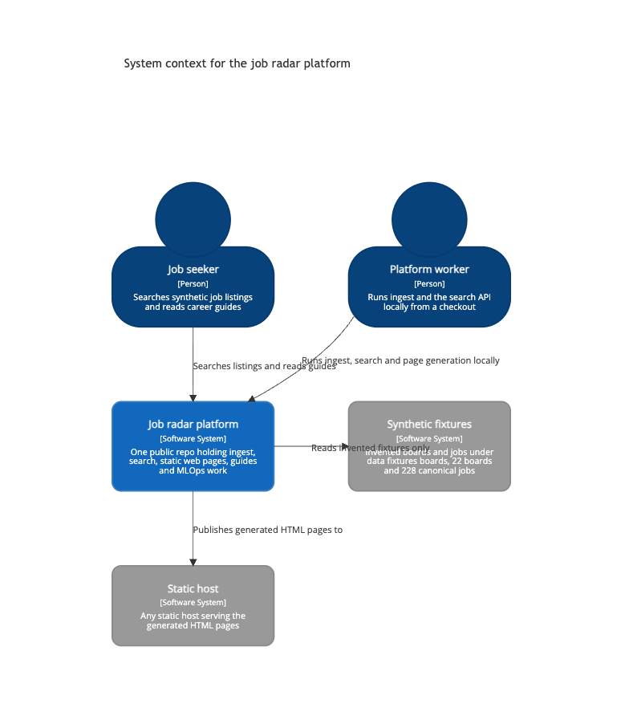
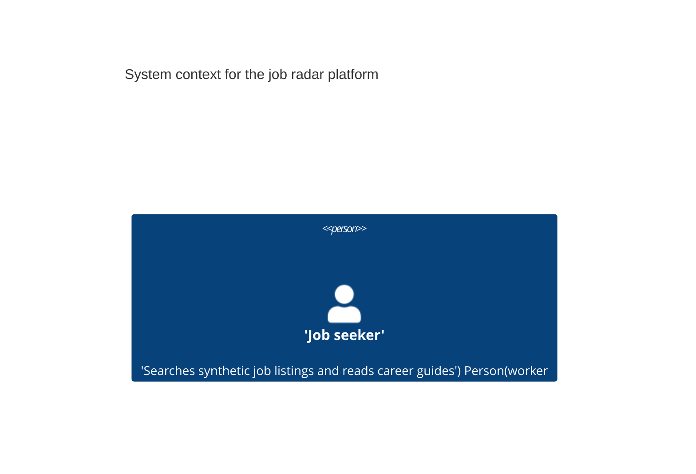
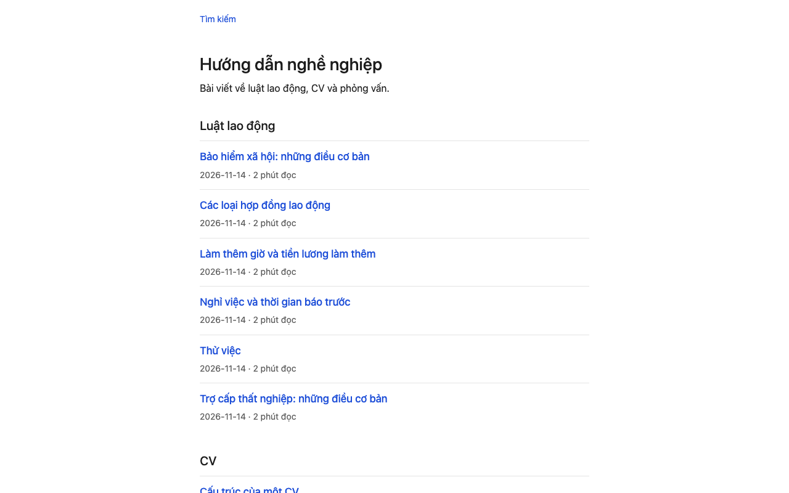
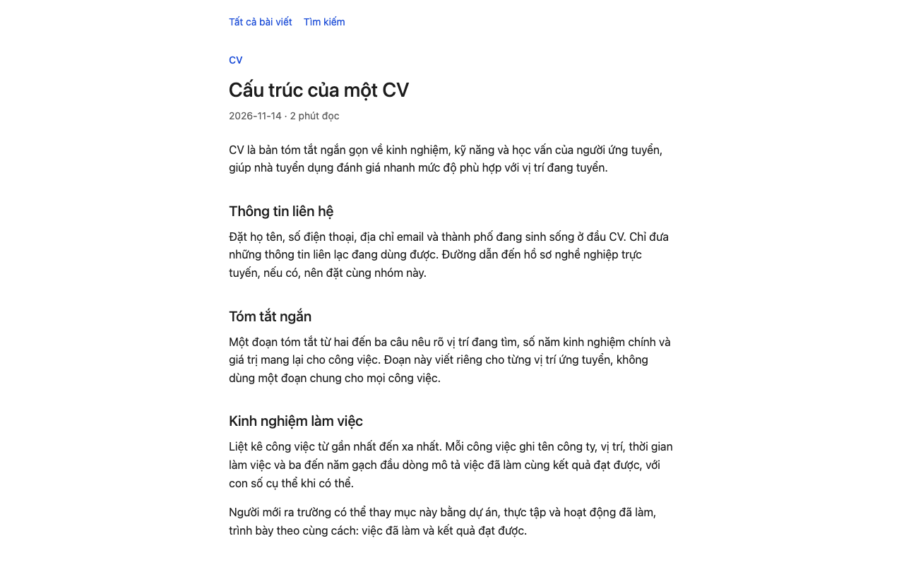
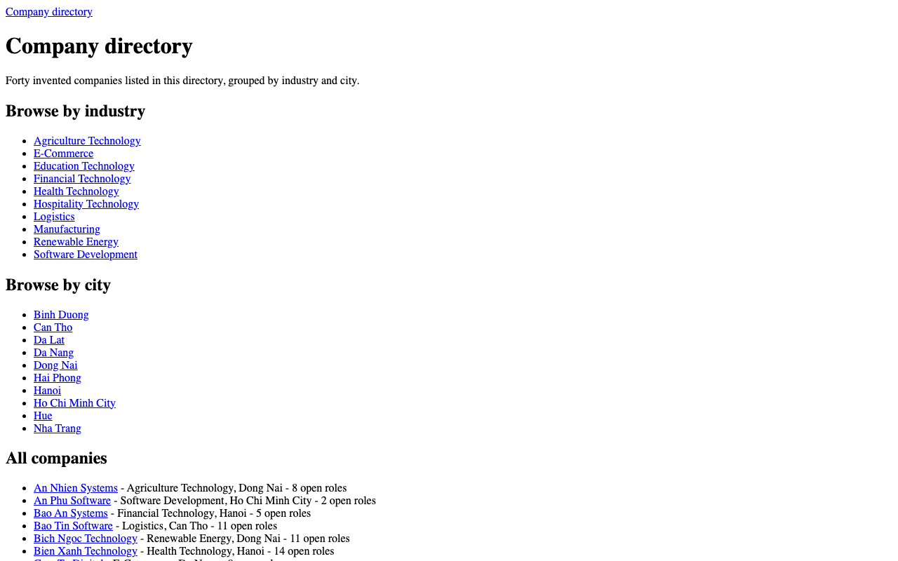
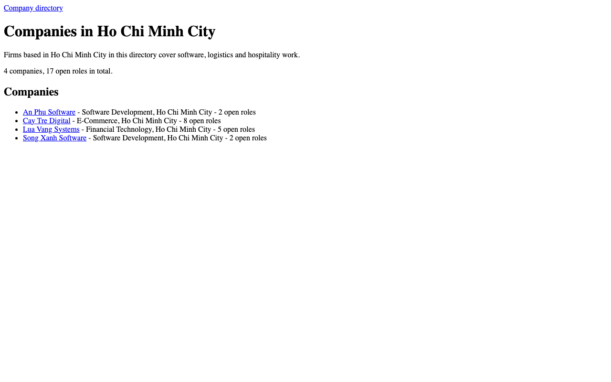
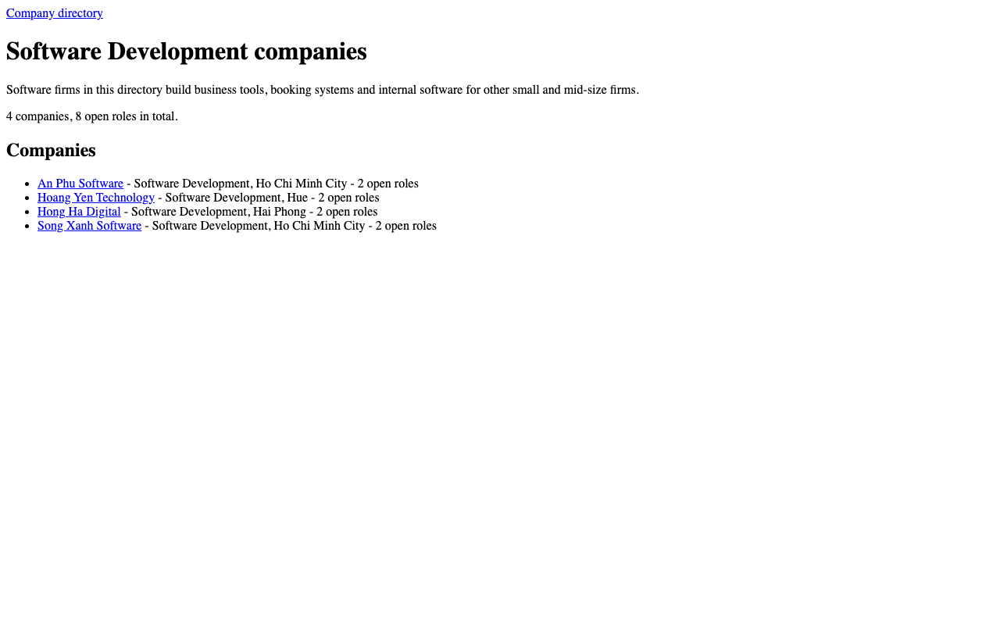

# Job radar

One public repo holding ingest, search, static web pages, guides and MLOps work. All data is synthetic. No real board is contacted and no real listing is copied.

## Quickstart

Prerequisites: python3 on the path, a checkout of the repo, port 8000 free for the search API.

Search API:

```
python3 -m venv .venv
.venv/bin/pip install -r services/api/requirements.txt
.venv/bin/python services/api/main.py
```

Check it with `curl http://127.0.0.1:8000/health`. Expected reply: `{"status": "ok"}`.

Static pages:

```
python3 web/guides/generate.py
python3 web/pages-extra/generate.py
```

Both generators use the standard library only. Serve the output with any static file server.

MLOps, from the repo root with seed 42:

```
python3 mlops/data/generate.py --count 500 --seed 42
python3 -m mlops.ingest.run bronze silver gold
python3 -m mlops.features.build
python3 -m mlops.training.train --model salary --n 500 --seed 42 --out mlops/training/artifacts/salary --evaluate
```

## Architecture





More diagrams: [container](docs/platform/diagrams/container.mmd), [component for the search API](docs/platform/diagrams/component-search-api.mmd), [deployment mapping](docs/platform/diagrams/deployment.mmd). The deployment mapping is proposed.

## Services

Search API: FastAPI served by uvicorn on port 8000. It reads data/processed/jobs.json when present and falls back to services/api/tests/fixtures/sample-jobs.json, a synthetic sample of 14 jobs. Set JOBS_PATH to point at another jobs file in the canonical schema. Endpoints cover health, listing jobs with filters, getting one job by id, redirecting to the job source URL, and listing filter values.

Ingest pipeline, in order: services/ingest/normalize.py, services/ingest/docstore.py, services/ingest/store.py, services/ingest/dedupe.py. Inputs are the fixtures under data/fixtures/boards. Outputs are the document store under data/raw, the SQLite store and the canonical jobs file.

MLOps serving: HTTP on 127.0.0.1 port 8001, endpoints /health, /models, /predict/salary, /predict/rank, /predict/match. See [mlops/README.md](mlops/README.md). Drift monitoring raises an alert when PSI is over 0.2 or KS is over 0.15 and exits 1.

Observability demo: `sh ops/observability/demo/run_demo.sh` starts a synthetic job listings app on port 18080 and records the observed output in ops/observability/demo/SMOKE.md.

## Guides

The guides generator reads Markdown articles from web/guides/articles and writes index.html, search.html, search.json and one page per article. The pages-extra generator reads data/companies.json and writes the site under web/pages-extra/site.

### Screenshots








## Platform docs

Architecture decisions, runbooks, data dictionary and diagrams live under [docs/platform](docs/platform).

- Decisions: docs/platform/adr, 12 records numbered 0001 to 0012
- Runbooks: docs/platform/runbooks, local run, verify failure triage, release, incident response for a bad merge, onboarding a new worker
- Data dictionary: docs/platform/data-dictionary.md
- Diagrams: docs/platform/diagrams, context, container, component for the search API, deployment mapping
- Checks: python3 docs/platform/check.py

## Verification

There is no make verify target in this checkout. Run the checks below from the repo root:

```
python3 docs/platform/check.py
python3 -m unittest discover mlops
python3 -m pytest services/api/tests
```

End to end, from the repo root:

```
make mlops-e2e
```

A real run writes its full output to docs/evidence/mlops/e2e-YYYY-MM-DD.log.
